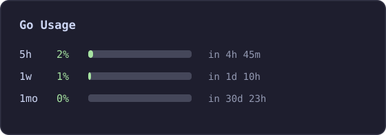

<div align="center">

# opencode-go-usage-v2

**把 OpenCode Go 的套餐用量，一直摆在你的终端侧边栏。**

一个超小的 **OpenCode v2** CLI 插件：显示 Go / Go Plus 套餐用量
（滚动 5 小时 · 每周 · 每月），带进度条和重置倒计时。

[](LICENSE)


**[English](README.md) · [中文](README.zh.md)**



<sub>侧边栏文件区下方的「Go Usage」区块（示意图）。</sub>

</div>

---

## 为什么做它

OpenCode Go 是 $10/月 的订阅，用量按滚动窗口统计（5小时 / 周 / 月）。
这个插件把数字一直摆在眼前——不会被任务半途限流，也随时知道什么时候重置。

## 功能

- 🎛 **侧边栏区块** —— 挂在 `sidebar.content`，文件区正下方
- 📊 **三个窗口** —— 5小时 / 周 / 月：百分比 + 进度条 + “还有多久重置”
- ⏱ **自动刷新** —— 默认每 2 分钟；每次刷新重读凭据，自动跟上 OAuth 令牌轮换
- ⌨️ **`/gousage` 命令**（命令面板里叫 *Refresh Go usage*）随时手动刷新
- 🔌 **零配置** —— 自动读取 `opencode.db` 里的 OpenCode Console 登录
- 🖥 **跨平台** —— `OPENCODE_DATA_DIR` / `XDG_DATA_HOME` / `LOCALAPPDATA` / 默认路径
- 🔒 **不消耗额度** —— 只读官方接口 `https://opencode.ai/zen/go/v1/usage`

## 安装

```bash
git clone https://github.com/ZhaoPengpeng1116/opencode-go-usage-v2 ~/.config/opencode/plugins/go-usage
```

然后**完全重启** OpenCode。打开会话、显示侧边栏 —— 文件区下方就是「Go Usage」。

> **要求**：OpenCode **v2**（在 2.0.32 测试通过）+ 已登录 **OpenCode Console** 且有
> Go / Go Plus 订阅（`opencode auth login opencode`）。
> 这是 CLI 侧插件槽——支持终端 TUI；桌面版/网页版未验证。

### 可选配置

通过 `cli.json` 以对象形式加载时可传参：

```json
{
  "plugins": [
    {
      "package": "/absolute/path/to/opencode-go-usage-v2",
      "options": { "refreshInterval": 120 }
    }
  ]
}
```

| 选项 | 类型 | 默认 | 说明 |
| --- | --- | --- | --- |
| `refreshInterval` | number | `120` | 自动刷新间隔（秒，最小 15） |

## 常见问题

**数字和网页控制台对不上？**
凭据读取顺序：`OPENCODE_API_KEY` 环境变量 → **`opencode.db` 里的 Console 登录** → `auth.json` 旧 key。
如果你同时有 v1 旧 key 和 v2 Console 登录，插件优先用 Console 登录（网页显示的就是它）。
（旧 v1 key 查同一接口可能返回旧周期/旧账户的数字。）

**侧边栏里看不到这个区块？**
1. 先**完全重启** OpenCode（CLI 插件在启动时加载）；
2. 区块在**会话侧边栏**里：把侧边栏打开（终端够宽会自动显示，也可以用命令面板切换）。

**我只用第三方 API key（没登录 Console）？**
没有可显示的数据——区块会显示 `no credential`。本插件面向 OpenCode Go 订阅用户。

## 卸载

```bash
rm -rf ~/.config/opencode/plugins/go-usage
```

## 协议

[MIT](LICENSE) · 非官方社区插件，与 OpenCode 官方无关联。
如果它帮你省了一次“用完才发现”，点个 ⭐ 让更多人找到它。
